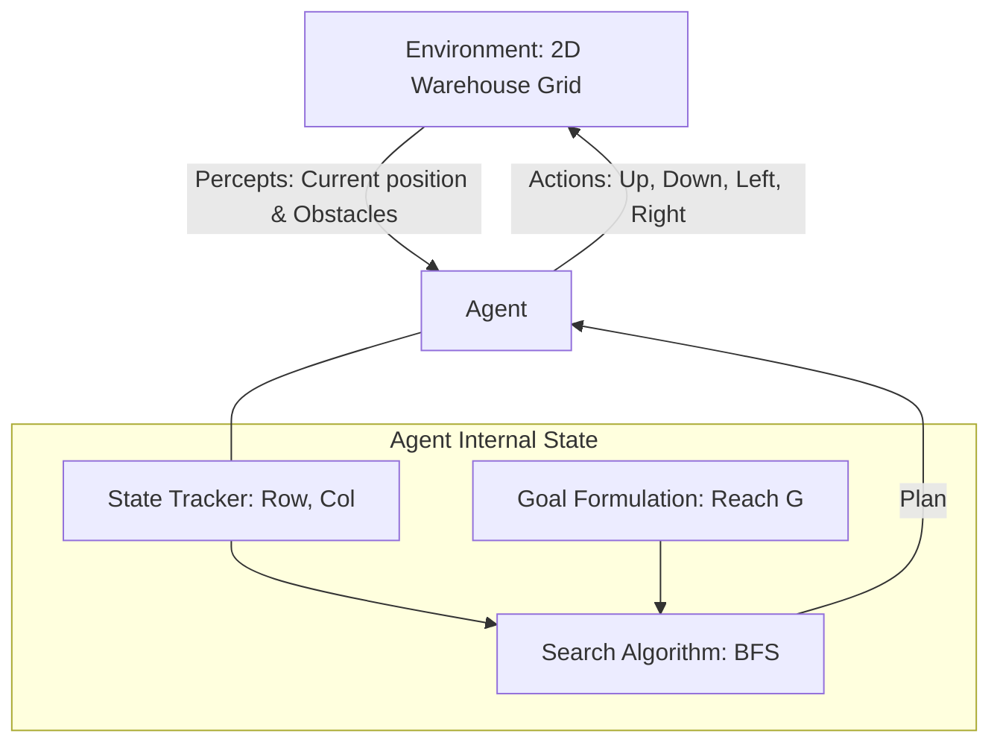

# Agents: Laboratory Exercise

## Task 1 – Understanding the Problem
1. **What is the environment?**
   The environment is a discrete, deterministic, fully observable, and static 2D grid representing a warehouse. It contains free spaces (`.`), obstacles (`#`), a starting point (`S`), and a goal (`G`).

2. **What is the goal of the agent?**
   The goal of the agent is to transport packages from the loading bay (`S`) to the dispatch area (`G`) by finding a collision-free path.

3. **What actions are available to the agent?**
   The agent can move in four directions: `Up`, `Down`, `Left`, `Right`. One move changes the position by one grid square.

4. **What information must the agent maintain in order to choose its next action?**
   The agent must maintain its current state (coordinates in the grid) and an internal model of the world (the warehouse map) to anticipate obstacles. It also needs a goal state and a plan (e.g., path or search frontier) to decide the sequence of actions.

5. **Why is this an example of a goal-based agent rather than a simple reflex agent?**
   A simple reflex agent only acts based on the current percept (its immediate surroundings), which is insufficient for navigating a maze-like warehouse because it can easily get stuck in dead ends. A goal-based agent considers the future implications of its actions (via search/planning) to achieve a specified goal state before acting.

**Think About It**
If the warehouse becomes twice as large, the search space grows exponentially. Breadth-First Search (BFS) would still technically be appropriate and correct, but it might become highly inefficient in terms of memory and time. Additional difficulties include the need for informed search heuristics (like A*) to guide the search towards the goal more efficiently to prevent resource exhaustion.

## Task 2 – Designing the Agent
* **The environment:** The 2D grid matrix of the warehouse.
* **The current state:** The `(row, column)` coordinates of the agent.
* **The goal:** Reaching the specific `(row, column)` coordinates of `G`.
* **The available actions:** Transitions `Up`, `Down`, `Left`, `Right` to adjacent non-obstacle cells.
* **The decision-making component:** A search algorithm (BFS) that explores the state space from `S` to `G` and returns a sequence of actions.

**Block Diagram**

## Task 3 – Prompt Engineering

1. **Did the LLM generate a working program on the first attempt?**
   Yes, providing a precise specification covering the grid representation, constraints, output requirements, and algorithmic explanation resulted in a functional program immediately.
2. **If not, how can you improve your prompt?**
   (N/A - It worked on the first attempt. However, a general improvement is to explicitly specify the grid dimensions, clarify edge cases like moving out of bounds, and restrict the usage of external libraries).
3. **What search algorithm did the LLM choose?**
   The LLM chose Breadth-First Search (BFS).
4. **Why do you think the LLM selected this algorithm?**
   BFS is the standard algorithm for finding the shortest path on an unweighted graph (where every movement costs exactly 1). It is guaranteed to be optimal for this specific problem and is conceptually simpler to implement than informed search algorithms like A* when a heuristic is not strictly requested.
